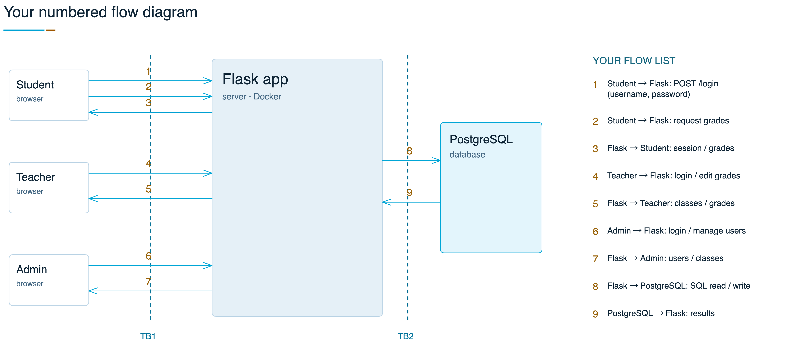
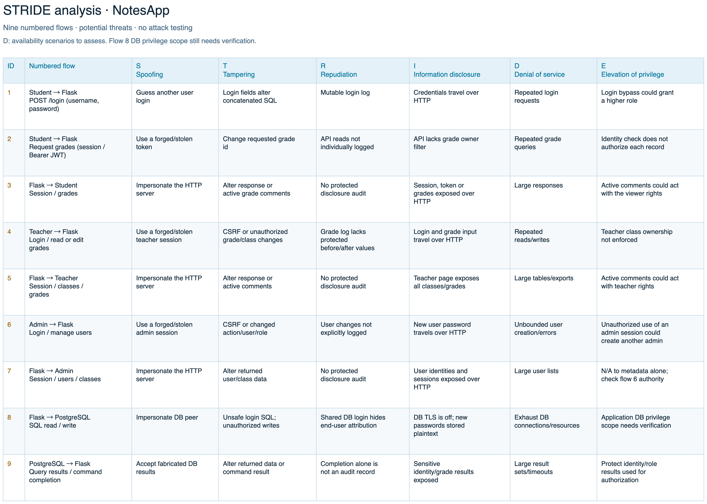

# NotesApp - Session 02 lab

**Group:** ZIQIAN YU (2023902046); HAOJIE SONG (2023905496).

Fork: https://github.com/pursurer/NoteApp. Baseline: teacher commit [`8d5916436b7516547898b17fc856a54807b3638f`](https://github.com/KristenPire/NoteApp/tree/8d5916436b7516547898b17fc856a54807b3638f).

## Numbered data-flow diagram

The diagram follows course slide 34: three browsers, a larger Flask block, PostgreSQL, TB1/TB2 and a short flow list. Each of its nine numbered arrows maps to one STRIDE row.
Teacher/Admin traffic and DB operations are grouped to keep the diagram readable. Auxiliary health, static assets, audit storage, CSV details and Admin Ping subprocess flows are outside this compact drawing.

The diagram and the STRIDE table were drawn in https://excalidraw.com/ and exported as PNG.

## Flow list

| ID | Sender -> receiver | Data | Boundary |
|---|---|---|---|
| 1 | Student -> Flask | POST /login (username, password) | TB1 |
| 2 | Student -> Flask | Request grades (session / Bearer JWT) | TB1 |
| 3 | Flask -> Student | Session / grades | TB1 |
| 4 | Teacher -> Flask | Login / read or edit grades | TB1 |
| 5 | Flask -> Teacher | Session / classes / grades | TB1 |
| 6 | Admin -> Flask | Login / manage users | TB1 |
| 7 | Flask -> Admin | Session / users / classes | TB1 |
| 8 | Flask -> PostgreSQL | SQL read / write | TB2 |
| 9 | PostgreSQL -> Flask | Query results / command completion | TB2 |

## First STRIDE table

[class2-stride.csv](class2-stride.csv) contains nine rows. S: Spoofing; T: Tampering; R: Repudiation; I: Information disclosure; D: Denial of service; E: Elevation of privilege. Entries are potential threats supported by inspected source, not successful exploit results.
The D column lists availability scenarios to assess; no load tests or resource-impact measurements were performed. Flow 8 database grants still need verification. Legitimate admin user creation alone is not privilege escalation.
The table has the requested ten columns: ID, Sender -> receiver, Data, Boundary, S, T, R, I, D, E. The image below is the exported STRIDE section.
STRIDE definitions: https://learn.microsoft.com/en-us/biztalk/core/identifying-potential-threats .

## Observation and source

41 normal HTTP requests covered anonymous, student, teacher and admin states. The student read their own seeded grade, the teacher page showed grade IDs, and the database digest was unchanged.
The grade, user-management and Ping POST forms were inspected but not submitted. No attack payloads or load tests were used. DB flows were reconstructed from code, not packet capture.

Evidence: the HTTP observation log, web/app.py, web/templates, db/init.sql, docker-compose.yml. PostgreSQL SHOW ssl returned off. The observation ran with a local Compose overlay that bound localhost:8080, hid the DB host port and removed web host mounts.

Project 1 turns this diagram and STRIDE table into the full risk analysis: see [the Project 1 report](project1-risk-analysis.md).
