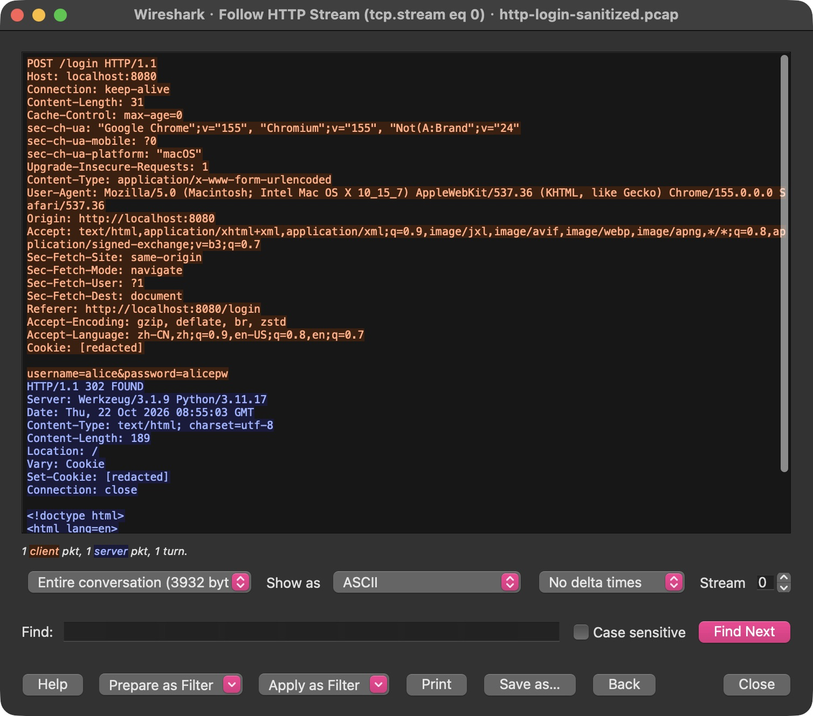
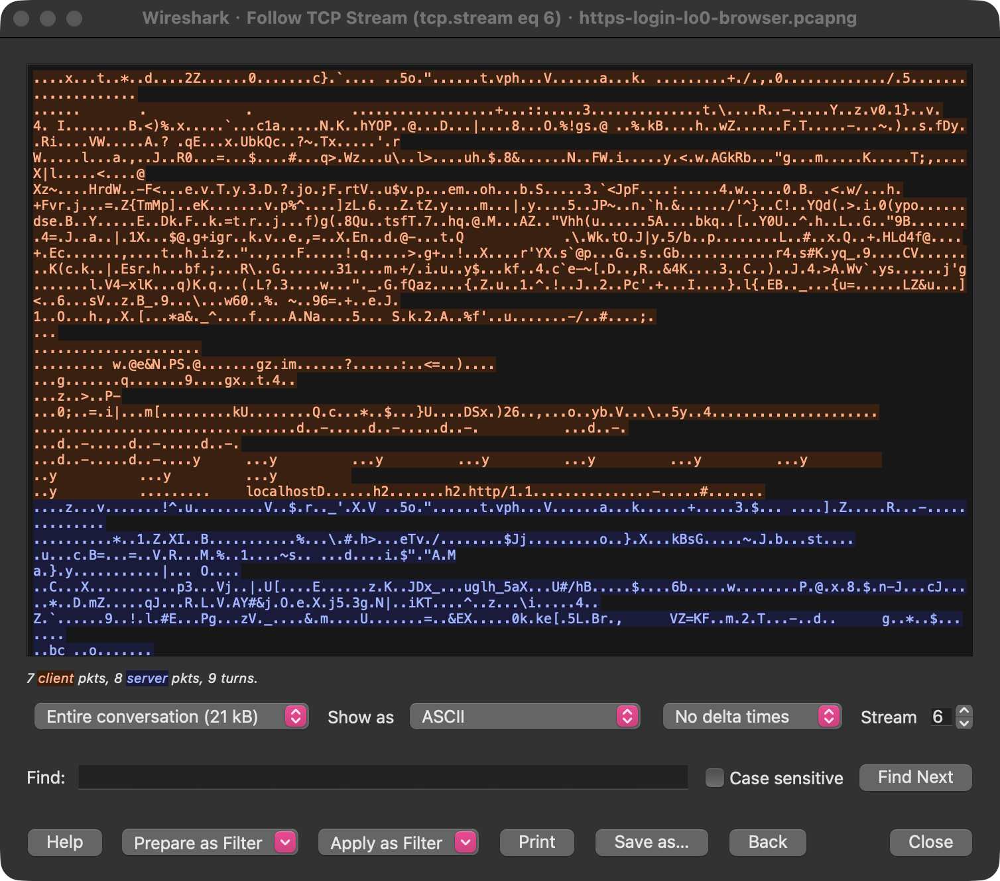
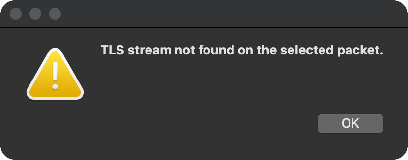
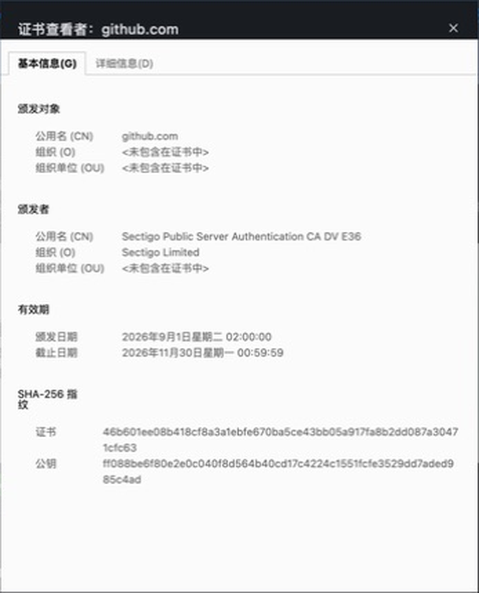
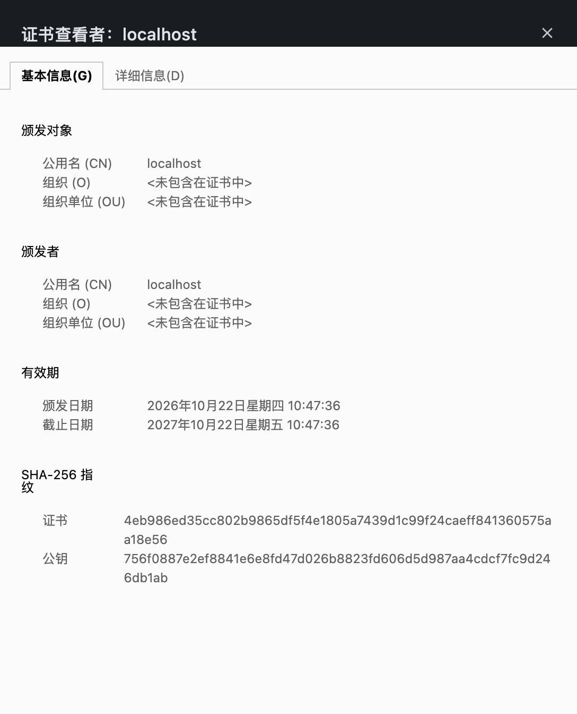
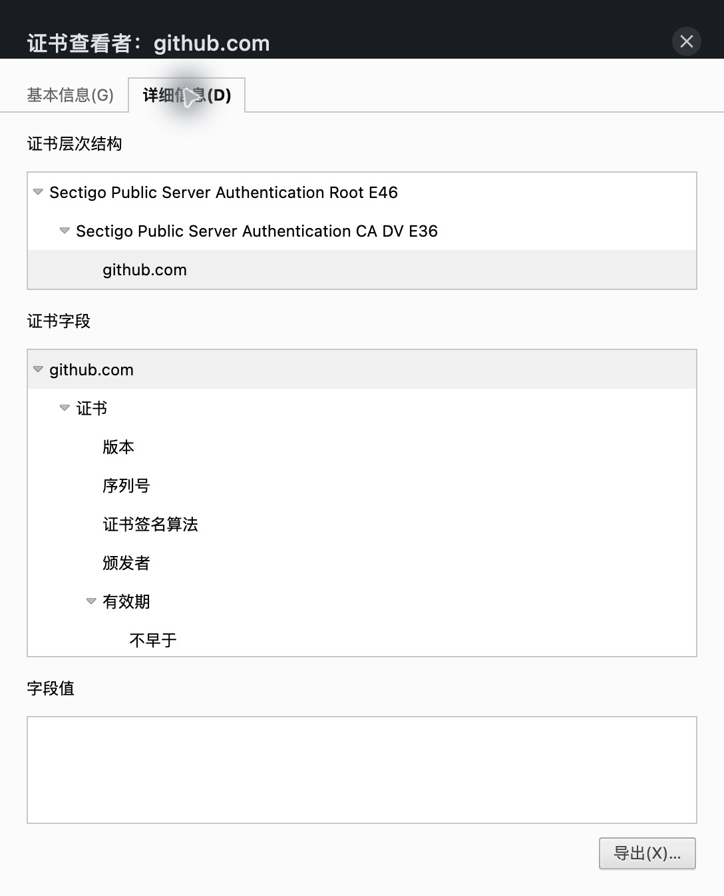
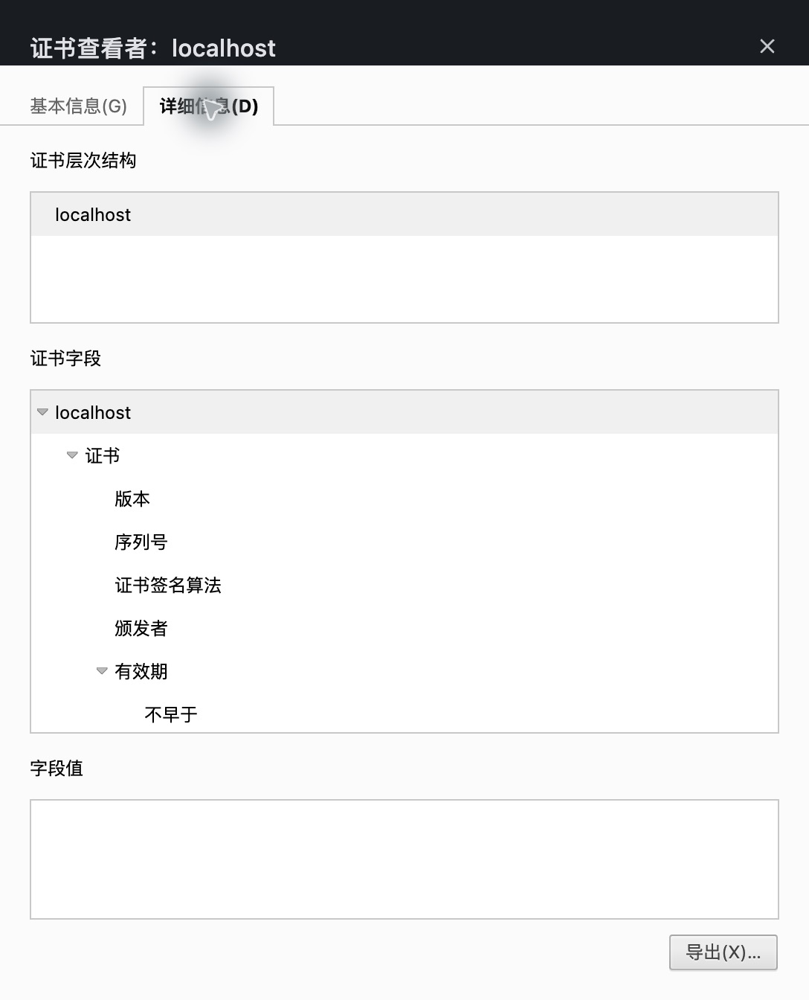

# NotesApp Transit Audit — Class 5, Lab 1

**Pair:** HAOJIE SONG (2023905496); ANGRAN YU (2023900899)  
**Course:** Computer Security — EPITA · Kristen Pire  
**Date:** 22 October 2026  
**Target:** only our own machine's loopback traffic, to our own NotesApp clone on `localhost`, with the course test account `alice`.

## Audit summary — hand this in

```text
NOTESAPP TRANSIT AUDIT — pair: HAOJIE SONG (2023905496); ANGRAN YU (2023900899)

FINDING 1 — login over plain HTTP
  Exposed:      the username and the password, in clear text
                (before-screenshot: the "username=alice&password=alicepw" line)
  Who reads it: anyone who can see the traffic, e.g. anyone on the same shared
                Wi-Fi (café, airport) with a free sniffer such as Wireshark,
                the network operator, any device on the path
  Severity:     High because the password is readable with a free tool in a few
                minutes, with no special access, and it lets the attacker log in
                as the user
  Fix:          serve NotesApp only over HTTPS (nginx terminates TLS), redirect
                HTTP to HTTPS, and close the plain-HTTP port 8080

FIX VERIFIED — re-captured under HTTPS: password readable?  No (after-screenshot)

FINDING 2 — certificate trust
  GitHub issued by: Sectigo Public Server Authentication CA DV E36
  Yours issued by:  localhost (itself: self-signed)
  Trust yours lacks: a signature from a Certificate Authority that the browser
                already trusts (a chain of trust to a trusted root)
  Verdict (encrypted vs trusted): No: encryption hides the data on the wire, but
                only a trusted CA signature proves who is on the other end, so
                our connection is encrypted but not trusted.

STATE: NotesApp now served over HTTPS (self-signed, for the lab).  ✅
```

## Lab worksheet

### Finding 1 — Can someone read a login on the wire?

**Predict first (our answer before the capture — yes or no, and why):** Yes, we think the password can be read. HTTP is not encrypted, so if the login is sent directly over HTTP, Wireshark can see the username and password in it.

**Record — what did the capture show?**

- Username and password readable? **Yes.**
- Exact line: `username=alice&password=alicepw`
- Before-screenshot: Fig. 1.

<p align="center"></p>

*Fig. 1 — Before. Wireshark, Follow → HTTP Stream of `POST /login` to `localhost:8080`. The line `username=alice&password=alicepw` is readable; the server answers `HTTP/1.1 302 FOUND` (login accepted). Cookie values of other local apps are masked as `[redacted]`.*

Capture: Chrome login at `http://localhost:8080`, Wireshark on the macOS loopback interface `lo0`, filter `tcp.port == 8080 and http`. Login request = frame 72, response `302 Found` = frame 75 (TCP stream 15). The screenshot is from the hand-in copy of this capture: it keeps only the login connection (frame 6, stream 0) and masks two unrelated cookie values. The login form is unchanged.

**Debrief — who, in the real world, could read it?** Anyone who can see the traffic reads the login the same way: another user of the same shared Wi-Fi with a free sniffer, the network operator, or any device on the path. No decoding is necessary.

```text
FINDING 1 — login in transit (plain HTTP)
  What's exposed:  the username and the password of the login, in clear text
  Evidence:        (before-screenshot, Fig. 1: the
                    "username=alice&password=alicepw" line in the HTTP stream)
  Who can read it: anyone who can see the traffic (shared Wi-Fi users with
                   Wireshark, the network operator, any device on the path)
  Severity:        High because a working password is read with a free tool in a
                   few minutes and gives full access to the account
  Fix (1 line):    serve NotesApp only over HTTPS and close plain HTTP (port 8080)
```

### Remediation — put HTTPS in front of NotesApp

1. Self-signed certificate: the lab's command `openssl req -x509 -nodes -days 365 -newkey rsa:2048 -subj "/CN=localhost"` (RSA 2048, valid 1 year, `CN=localhost`); our certificate also has a SubjectAltName (`DNS:localhost`, `IP:127.0.0.1`). The private key `notesapp.key` is not committed and is not part of this report.
2. `nginx/nginx.conf` as given in the lab: port 80 returns `301` to `https://$host$request_uri`; port 443 uses `listen 443 ssl` with our certificate and key; `proxy_pass http://web:5000` with the `Host` and `X-Real-IP` headers. We added one line, `ssl_protocols TLSv1.2 TLSv1.3`.
3. `docker-compose.https.yml` as given: `web` gets `ports: !reset []` and `expose: "5000"`; an `nginx` service publishes 443 and 80. Our version uses the `nginx:1.27-alpine` image and publishes the ports on `127.0.0.1` only.
4. `docker compose ps` shows three containers, `db`, `web` and `nginx`; `web` has no published port (only `5000/tcp` inside Docker). `http://localhost/login` returns `301` to `https://localhost/login`; port 8080 refuses connections.

**Checkpoint — HTTPS is running.** Chrome loads the NotesApp login page at `https://localhost/login` after the certificate warning is accepted.

### Finding 1, re-tested — did the fix actually close it?

**Predict first (our answer before the re-capture — readable or not, and why):** No, we think the password can no longer be read directly. HTTPS encrypts the content in transit: Wireshark can still capture the packets, but it only sees the encrypted content.

**Record — what did this capture show?**

- Username or password anywhere in the stream? **No.**
- After-screenshot: Fig. 2, next to the before-screenshot (Fig. 1).

<p align="center"></p>

*Fig. 2 — After. The same Chrome login as `alice` / `alicepw`, now at `https://localhost`, captured with Wireshark on `lo0` (filter `tcp.port == 443`). Follow → TCP Stream of the login connection (`tcp.stream eq 6`): only the server name `localhost` and the protocol names `h2` / `http/1.1` from the TLS handshake are readable. The login request and the answers are encrypted bytes.*

<p align="center"></p>

*Fig. 2b — The lab's step, right-click → Follow → TLS Stream: Wireshark answers "TLS stream not found on the selected packet". Without the session keys it cannot decrypt TLS, so there is nothing to follow. Follow → TCP Stream (Fig. 2) shows the bytes as they cross the wire.*

Capture: the same attack as Finding 1 — Chrome, Wireshark on `lo0`, port 443 only. Login at 13:40:17; nginx logged `POST /login` → `302` and `GET /dashboard` → `200` in the same second, so the login worked. In the capture this is TCP stream 6: a TLS 1.3 handshake (`ClientHello` for `localhost`, frame 42), then only encrypted records. The browser's first request after the handshake is frame 50 (13:40:17.456). Stream 6 is the only Chrome connection that carries requests; the others are spare connections (handshake only) and refused IPv6 attempts. A later connection, stream 8 at 13:42:16, is a `curl` request for the login page, without credentials.

Check of the whole capture without session keys (215 packets, 0 dropped): 0 packets decoded as HTTP; the strings `username=`, `password=`, `alice`, `alicepw` and `POST /login` appear nowhere in the raw file.

### Finding 2 — Can you trust this HTTPS? (judge)

**Think it through.**

- Is "the connection is encrypted" the same as "the server is who it claims to be"? **No.** Encryption only hides the data. Anyone can make a certificate for any name in ten seconds, as we did; encryption does not prove who holds it.
- What is the warning complaining about? Not the encryption. Chrome says `NET::ERR_CERT_AUTHORITY_INVALID`: no Certificate Authority that the browser trusts has signed our certificate, so the identity of the server is not proven.

**Record — the one difference that matters.**

- GitHub's certificate — Issued by: **Sectigo Public Server Authentication CA DV E36** (Sectigo Limited)
- Our certificate — Issued by: **localhost** (itself)

| | GitHub (`https://github.com`) | NotesApp (`https://localhost`) |
|---|---|---|
| Issued to | `github.com` | `localhost` |
| **Issued by** | **Sectigo Public Server Authentication CA DV E36** | **localhost** (itself) |
| Chain of trust | `github.com` → Sectigo CA DV E36 → Sectigo Root E46 (trusted root) | `localhost` only, no chain |
| Browser | padlock, certificate valid | warning `NET::ERR_CERT_AUTHORITY_INVALID` |

<div class="grid">
<figure><figcaption>Fig. 3 — GitHub certificate, General tab. 颁发者 = Issued by: Sectigo Public Server Authentication CA DV E36, Sectigo Limited.</figcaption></figure>
<figure><figcaption>Fig. 4 — Our certificate, General tab. 颁发对象 (Issued to) and 颁发者 (Issued by) are both <code>localhost</code>: self-signed.</figcaption></figure>
<figure><figcaption>Fig. 5 — GitHub, Details tab: the certificate hierarchy goes up to a trusted root CA.</figcaption></figure>
<figure><figcaption>Fig. 6 — NotesApp, Details tab: the hierarchy has one entry, <code>localhost</code>. There is no CA above it.</figcaption></figure>
</div>

The browser interface is in Chinese: 颁发对象 = Issued to, 颁发者 = Issued by, 证书层次结构 = Certificate hierarchy.

```text
FINDING 2 — certificate trust
  GitHub issued by:  Sectigo Public Server Authentication CA DV E36
  Yours issued by:   localhost (self-signed)
  The trust yours lacks:  a signature from a CA the browser already trusts
                          (a chain of trust up to a trusted root)
  Verdict — is "encrypted" the same as "safe to trust"? Why (one sentence):
  No: encryption hides the data on the wire, but only a trusted CA signature
  proves who is on the other end, so our connection is encrypted but not trusted.
```

### Finished early (optional)

- **Downgrade check — done.** With HTTPS running, `http://localhost/login` (no `s`) gets `301 Moved Permanently` with `Location: https://localhost/login`. The app is not served over plain HTTP.
- **Wrong domain name — done.** We set `server_name notesapp.local` in `nginx/nginx.conf`, regenerated the certificate with `-subj "/CN=notesapp.local"`, reloaded nginx and revisited `https://localhost`. Even when we trust this certificate on purpose, the check fails on the name:

  ```text
  $ curl --cacert nginx/certs/notesapp.crt https://localhost/login
  curl: (60) SSL: certificate subject name 'notesapp.local' does not match target host name 'localhost'
  ```

  This is a name mismatch, a different failure from "untrusted issuer" (with our normal certificate, curl says `self signed certificate`). A phishing site that reuses a certificate for the wrong domain fails the same way. We then put back the original `localhost` certificate, key and `nginx.conf` (same SHA-256 as before the test).

### Cleanup (end of lab)

Done after the audit: we removed the HTTPS stack (`docker compose … -f docker-compose.https.yml down`) and started the plain-HTTP stack again (`docker compose … up -d`). NotesApp answers again at `http://localhost:8080`; the database volume is untouched (still 35 users, alice still stored with Argon2). The STATE line in the Audit summary records the state at the end of the audit, before this cleanup.
