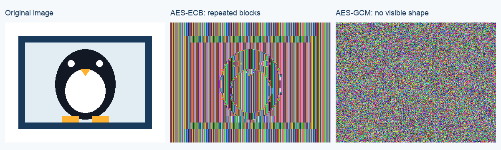

# Session 03 - Class lab and homework

Date: 8 October 2026. Updated: 22 October 2026. Source: `Session 03 Symmetric Encryption.pdf`, slide 30.

**Group:** ZIQIAN YU (2023902046); HAOJIE SONG (2023905496).

## Result

The three parts are complete in the local homework environment.

- Caesar: recovered shift 11 and the complete practice message.
- Image: ECB retained a visible outline. GCM hid the outline and rejected a changed byte.
- NotesApp: encrypted and verified 60 comments. All 17 tests passed.

## 1. Break Caesar

The slides give no challenge ciphertext. This experiment uses an original practice message.
The cracking function receives only ciphertext. It receives neither the key nor the original message.

Count the English letters for each of the 26 shifts.
Compare each distribution with a fixed English frequency table.
Select the smallest chi-squared score.

`score = sum((observed - expected)^2 / expected)`

`expected = letter_count * reference_frequency`

| Rank | Shift | Score |
| --- | --- | --- |
| 1 | 11 | 116.45 |
| 2 | 22 | 1301.22 |
| 3 | 17 | 1810.64 |

Ciphertext:

```text
Esp defopyed fdp l dxlww laawtnletzy ez cplo esptc rclopd lyo nzxxpyed. L eplnspc nly pyepc l rclop lqepc plns wpddzy. Esp laawtnletzy vppad esp cpnzcod ty l olelmldp. Esp eplx xfde aczepne esp actglep nzxxpyed mpqzcp l apcdzy nly nzaj esp olelmldp. L dpncpe vpj nslyrpd esp cplolmwp epie tyez ntaspcepie. Esp dlxp vpj nslyrpd esp ntaspcepie mlnv tyez cplolmwp epie. Vppa esp vpj dpalclep qczx esp olel. Fdp l yph yzynp qzc plns xpddlrp. Nspnv esp lfespyetnletzy elr mpqzcp jzf fdp l nzxxpye. Cpupne l nzxxpye tq esp nspnv qltwd. Pyncjaetzy spwad aczepne dezcpo nzxxpyed, mfe esp laawtnletzy xfde lwdz nspnv hsz nly cplo plns cpnzco.
```

Recovered plaintext:

> The students use a small application to read their grades and comments. A teacher can enter a grade after each lesson. The application keeps the records in a database. The team must protect the private comments before a person can copy the database. A secret key changes the readable text into ciphertext. The same key changes the ciphertext back into readable text. Keep the key separate from the data. Use a new nonce for each message. Check the authentication tag before you use a comment. Reject a comment if the check fails. Encryption helps protect stored comments, but the application must also check who can read each record.

The same practice text passed all 26 shifts. Short or unusual messages can produce the wrong rank.
The most common letter is only a clue. Use the full distribution instead of relying on E alone.

## 2. Compare ECB and GCM



The input contains 331,776 raw RGB bytes. Both modes use the same image and the same experiment key.
The original image and ECB output each have 101 unique blocks among 20,736 blocks.
The GCM output has 20,736 unique blocks in this run.

ECB maps equal input blocks to equal output blocks. GCM hides the visible shape and checks an authentication tag.
Both modes recovered the exact original pixels. GCM rejected the changed ciphertext.

The program encrypts raw pixels. It does not encrypt compressed PNG file bytes.
PNG previews omit ECB padding and the GCM tag.
The complete encrypted byte files and public metadata are separate.
The key is discarded after verification. Rerun the script to repeat encryption and decryption.

## 3. Encrypt the NotesApp comment column

- Use AES-256-GCM with a 32-byte key.
- Generate a fresh 12-byte random nonce for each encryption.
- Store `gcm1:` followed by Base64 of `nonce || ciphertext || tag`.
- Use `NotesApp:notes:<note_id>:comment:v1` as associated data.
- Encrypt UTF-8 JSON to preserve text, empty text, Unicode, and null comments.
- Encrypt before insert or update. Reserve a new row ID before encryption.
- Authenticate and decrypt on the student, teacher, API, and CSV read paths.
- Stop startup if the key is absent. Reject invalid ciphertext with a generic error.

The migration uses a table lock and one transaction. It verifies all recovered values before commit.
A repeat migration verifies existing ciphertext without encrypting it again.
A database constraint rejects plaintext writes and raw null values.

The key generator creates a separate Docker key volume once. The file mode is 0600.
The launcher exports it as NOTESAPP_COMMENT_KEY. The application reads this environment variable. The DB service does not mount the key volume.
The key is not printed, exported, or included in the submission files.
Keep the key volume with the encrypted database. Key loss makes the comments unreadable.

## Verification

All 17 tests passed. They cover seven cipher tests and ten PostgreSQL application tests.
Four normal HTTP checks covered seeded student and teacher login, pages, API, and CSV.
The database has 60 encrypted comments and no raw null comment values.
The original October 8 experiment preserved the Session 02 database. On October 22, the default application was also migrated; see the current acceptance record.

Evidence:

- `results/caesar_results.json` and `caesar_verification.json`.
- `results/image_results.json` and `image_metadata.json`.
- `results/homework_test_results.json`.
- `results/migration_result.json`.
- `results/environment_verification.json`.

## Protection limits

Encryption protects the current comment column when the attacker cannot obtain its key.
Names, grades, and record structure remain visible.
GCM does not hide message length or prevent same-row replay of an older valid comment.
Earlier backups, database history, and seed SQL can retain plaintext.
The existing course login, access control, CSRF, active HTML, and command flaws remain.
A compromised web process can use its mounted key.
Production key isolation, rotation, and backup policies need separate work.

## Class question: how can colleagues share a key?

Use an authenticated encrypted channel. Verify the colleague's identity first.
Use a tested protocol, such as TLS. Do not send the key in plaintext.
Symmetric encryption alone does not establish trust in the other person.

## References

- Course slides: 6-8, 25, 27-28 and 30.
- [AESGCM API](https://cryptography.io/en/50.0.0/hazmat/primitives/aead/).
- [NIST GCM specification](https://csrc.nist.gov/pubs/sp/800/38/d/final).
