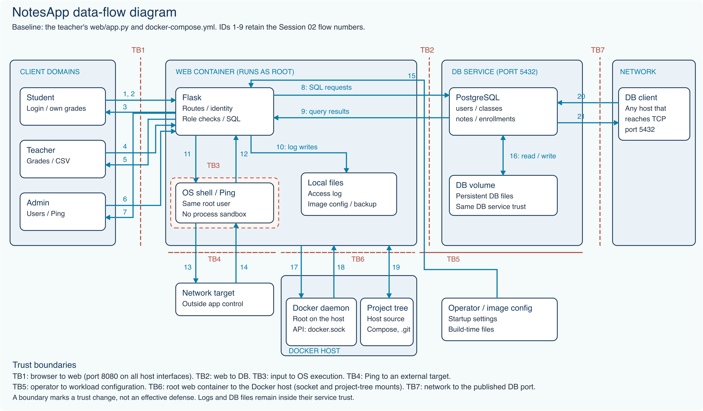

# Project 1 - NotesApp risk analysis

Date: 8 October 2026. Updated: 22 October 2026. Course source: `Session 03 Symmetric Encryption.pdf`, actual PDF page 31.

**Group:** ZIQIAN YU (2023902046); HAOJIE SONG (2023905496).

## Scope

The baseline is the teacher's original `web/app.py` and `docker-compose.yml`. All code references below resolve inside `baseline/`, a pinned evidence snapshot. They do not refer to the updated application.
The Git baseline is `8d5916436b7516547898b17fc856a54807b3638f`.
The Compose file publishes web port 8080 and DB port 5432 on all host interfaces.
The web container runs as root and mounts the host Docker socket and the project tree.
Runtime DB checks used the loopback-only local overlay `compose.lab.yml`. The overlay changes ports, mounts, networks, and resource limits. It does not change DB settings.

Protect identities, grades, comments, credentials, sessions, audit records, and availability.
Code and configuration support the listed threats. No exploit or load test was run for this analysis.
C3 and C4 now run in the default application. The historic 8083 environment remains available with its own database and keys. This risk analysis still describes the original baseline.

## Data-flow diagram

`data_flow.svg` is the editable vector version. The first nine flow IDs retain the Session 02 numbering.

- TB1: browser to web service.
- TB2: web service to PostgreSQL.
- TB3: application input to OS command execution. The baseline has no process sandbox.
- TB4: OS Ping to an external network target.
- TB5: trusted operator to workload settings and image files.
- TB6: root web container to the Docker host, through the Docker socket and project-tree mounts.
- TB7: any network client to the published PostgreSQL port.

Logs and DB files share the trust of their services. A drawn boundary is not proof of an effective defense.
`flows.csv` lists 21 numbered flows: browser requests, CSV, audit files, Ping, startup settings, DB persistence, the host mounts, and direct DB clients.
The Ping network flows are inferred from code. They were not captured.
Flows 17-19 exist because of the Compose mounts. The application code does not use them; any process in the root container can.
Flows 20-21 come from any client that reaches the published DB port.

## Risk method

Score = likelihood x impact. Each value uses a scale from 1 to 5.
These are analyst estimates, not measured attack probabilities.
Likelihood describes ease after the stated prerequisite. Impact describes the resulting loss.

Likelihood: 1 rare, 2 restricted path, 3 plausible with conditions, 4 few resisting controls, 5 direct low-effort path.
Impact: 1 minor, 2 limited, 3 material disruption, 4 broad private-data or grade loss, 5 admin/OS/DB control.

High: 15-25. Medium: 6-14. Low: 1-5.
Equal scores do not establish a meaningful difference in risk. Related threats can share causes.

## STRIDE register

S = Spoofing. T = Tampering. R = Repudiation.
I = Information disclosure. D = Denial of service. E = Elevation of privilege.

| ID | STRIDE | Flows | Threat | Prerequisite | L | I | Score | Fix | Evidence |
| --- | --- | --- | --- | --- | --- | --- | --- | --- | --- |
| R01 | S/E | 1-7 | Forge an identity through weak token or session verification | Know the published demo configuration or send an unsigned API token | 5 | 5 | 25 | Reject unsigned tokens; use a tested verifier; use independent random signing keys; expire sessions | web/app.py:29-33;78-115;123-131 |
| R02 | T/E | 1 | Change the login SQL through user input | Access the login form | 5 | 5 | 25 | Use a parameterized login query; verify a password hash; use a restricted DB role | web/app.py:145-158 |
| R03 | I/T | 2, 4, 5, 8, 9 | Read or change grades outside the user's scope | Have a student or teacher identity | 5 | 4 | 20 | Check note ownership and teacher class ownership on API reads; writes; pages; exports | web/app.py:201-224;227-307 |
| R04 | I | 8, 9, 16 | Read private comments from a copied database | Obtain database files or a backup copy | 3 | 4 | 12 | Encrypt comments with AES-GCM; keep the key separate; control backup retention | db/init.sql:30-36;web/app.py:260-268 |
| R05 | T/E | 6, 11, 12 | Execute shell commands through Admin Ping | Have an admin session or compromise it | 3 | 5 | 15 | Remove shell execution; pass a fixed argument list; validate the host; reduce OS privileges | web/app.py:324-340 |
| R06 | T/E | 3, 5, 8, 9 | Run active content through a stored comment | Write a comment that a victim later reads | 3 | 4 | 12 | Keep HTML autoescape enabled; use an allowlist sanitizer only when rich text is required | web/templates/teacher.html:47;web/templates/dashboard.html:13-14 |
| R07 | T | 4, 6 | Submit a state change from another website | The victim has a live teacher or admin browser session | 3 | 4 | 12 | Validate CSRF tokens on every state-changing request; set appropriate cookie attributes | web/app.py:247-273;324-341;363-379 |
| R08 | R | 4, 6, 10 | Deny or alter a sensitive action record | Have access to weak logs or act through an identity that cannot be trusted | 4 | 3 | 12 | Record actor; action; target; result; before/after values; protect audit storage | web/app.py:38-45;271;339;363-379 |
| R09 | I | 15, 16 | Recover passwords or credentials from stored material | Read the course image, its bundled backup, or a copied user table | 3 | 5 | 15 | Hash user passwords; remove bundled credential backups; restrict file and secret access | db/init.sql:6-12;web/Dockerfile:13-23 |
| R10 | I | 1-7 | Read credentials or session data on an HTTP path | Control a network path between a browser and the published HTTP port | 3 | 4 | 12 | Use authenticated HTTPS for network use; protect session cookies | web/app.py:392-394;docker-compose.yml:28-29 |
| R11 | I | 8, 9, 20, 21 | Read database traffic without DB TLS | Control a transport path to the DB | 2 | 4 | 8 | Use verified DB TLS where the network is not trusted; restrict DB connectivity | Runtime SHOW ssl = off;docker-compose.yml:11-12 |
| R12 | D | 1, 2, 4, 6, 8, 20 | Exhaust the app or DB with repeated expensive requests | Access a permitted request path or the published DB port | 3 | 3 | 9 | Set rate and request limits; use pagination; bound DB work; add timeouts | web/app.py:48-54;227-244;276-307;docker-compose.yml has no resource limits |
| R13 | I | 1, 7 | Expose implementation details through errors or debug mode | Trigger an error on a reachable course route | 3 | 3 | 9 | Disable the debugger; return generic errors; keep detailed diagnostics in protected logs | web/app.py:157-160;383-394 |
| R14 | E | 8, 9 | Use the application DB login with excessive DB authority | Execute attacker-controlled SQL through the application, for example R02 | 3 | 5 | 15 | Use a non-superuser app role with only the required table and sequence grants | Runtime current_user role flags: superuser;createdb;createrole |
| R15 | S/T/I/E | 20, 21 | Log in to PostgreSQL directly through the published port | Reach TCP 5432 on the host; the password is in the public Compose file | 5 | 5 | 25 | Remove the published DB port; keep the DB on an internal network; keep the DB password outside the repository; use a non-superuser app role | docker-compose.yml:5-7;11-12;25;Runtime current_user role flags: superuser |
| R16 | T/I/E | 11, 17, 18, 19 | Take control of the Docker host through the mounted Docker socket or project tree | Run a command in the web container, for example through R05 | 3 | 5 | 15 | Remove the Docker socket and project-tree mounts; run the web container as a non-root user; drop Linux capabilities | docker-compose.yml:33-37;web/Dockerfile:24;web/app.py:324-340 |
| R17 | I/D | 6, 13, 14 | Use Admin Ping to probe internal hosts or send traffic to other networks | Have an admin session or compromise it | 3 | 2 | 6 | Allow only approved Ping targets; block internal and link-local ranges; rate-limit Ping requests | web/app.py:324-340;docker-compose.yml has no egress restriction |
| R18 | S/T | 14 | Return false Ping results through spoofed DNS or ICMP replies | Control DNS resolution or the network path to the target | 2 | 2 | 4 | Treat Ping output only as a hint; prefer IP targets or verified DNS; confirm service health with an authenticated check | web/app.py:330-341 |

Each row in `risks.csv` also states its evidence status. The register covers all six STRIDE letters, and every numbered flow appears in at least one row.
R01 has two paths. An unsigned JWT affects API identity.
A forged Flask session can affect session-only teacher or admin gates.
The application DB role is a superuser and can create databases and roles.
These role flags were checked directly. No privileged operation was attempted.
R15 is the direct network path to the database. R04, R09, and R14 cover copies and SQL paths through the application.
No DB login, host access, or network probe was attempted.

## Top three risks and proposed fixes

### R01 - Forge an identity: 25

Reject unsigned and unexpected JWT algorithms. Use a maintained verifier and check required claims and expiry.
Generate independent random signing keys for tokens and Flask sessions. Keep the keys outside source code.
Invalidate sessions signed with the old demo keys.

Acceptance checks: reject unsigned tokens, changed tokens, and old forged sessions.
Confirm that valid users retain their permitted access.

### R02 - Login SQL injection: 25

Parameterize the login query. Verify a password hash.
Use a non-superuser DB role with only the required table and sequence grants.

Acceptance checks: input cannot change SQL structure. Valid logins work. Invalid credentials fail.
The application DB role cannot manage other roles.

### R15 - Direct DB login through the published port: 25

Remove the published 5432 port. Keep PostgreSQL on an internal Docker network that only the web service can reach.
Generate the DB password outside the repository and pass it as a secret.
Give the application a non-superuser role with only the required grants.

Acceptance checks: a client outside the Docker network cannot open TCP 5432. The old published password fails.
The application still reads and writes grades.

R01, R02, and R15 tie. Each one bypasses the identity or access checks on which other defenses depend.
R03, missing record scope, follows with 20: check student note ownership and teacher class ownership on every read, write, page, and export.
The fixes above are proposals for the course baseline. They are not implemented by this risk report.

## Effect of Session 03 encryption

The homework addresses R04 for the current comment column when its key is unavailable to the attacker.
With it, a direct DB login (R15) reads only comment ciphertext; names, grades, and passwords stay exposed.
It does not establish a reduced risk for R01, R02, R03, or R15. The application still decrypts comments for its responses.
Other fields, old plaintext copies, and web-process key access remain relevant.

## Presentation and files

Use `PRESENTATION-3min.md` as the three-minute speaking outline.
Editable evidence is in `flows.csv`, `risks.csv`, and `data_flow.svg`.

## References

- Original `web/app.py`, `web/templates`, `web/Dockerfile`, `db/init.sql` and `docker-compose.yml`.
- Current baseline checks: DB TLS off and application DB role flags.
- [Microsoft STRIDE definitions](https://learn.microsoft.com/en-us/azure/security/develop/threat-modeling-tool-threats).
- Course slide 31.
